<p align="center">
  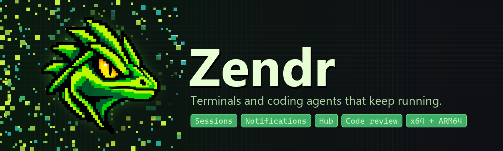
</p>

<p align="center">
  <a href="https://github.com/ruchira-edirisinghe/zendr/releases/latest"></a>
  
  <a href="LICENSE"></a>
  <a href="https://herdr.dev"></a>
</p>

<p align="center"><b>A calm home for your terminals and coding agents.</b><br>
Every session in one list. A drawer that tells you who needs you. A code reviewer next to the agent writing the code.<br>
Terminals that keep running when the window closes.</p>

<p align="center">
  <a href="#-install">Install</a> ·
  <a href="#-a-tour">Tour</a> ·
  <a href="#-keyboard">Keys</a> ·
  <a href="#-how-it-works">How it works</a> ·
  <a href="#-build-it-yourself">Build</a> ·
  <a href="#-thanks">Thanks</a>
</p>

---

<p align="center">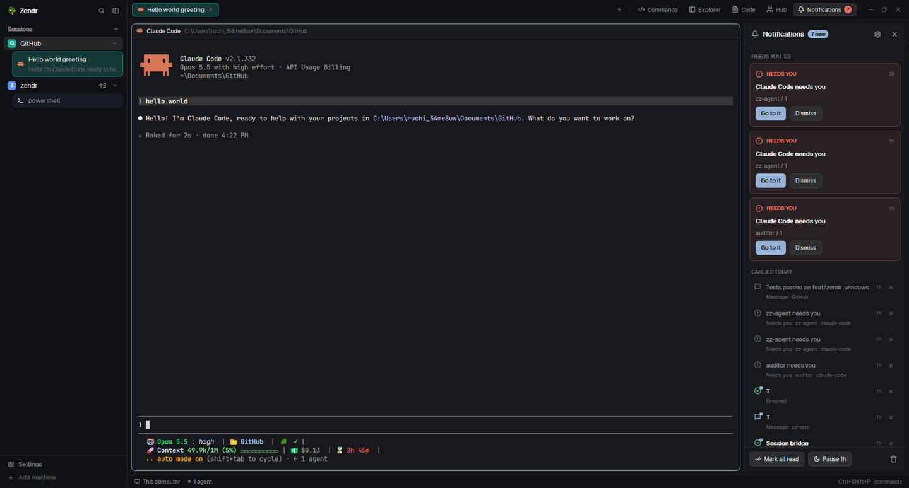</p>

You start three Claude Code sessions, a Codex run and a dev server. An hour later one agent is waiting on a yes/no question in a tab you forgot about, one has finished, and the server is still on port 5173. **Zendr shows you all of it at a glance.** The sidebar lists every session and says what each one is doing. The toolbar tells you how many need you. One click takes you there.

Zendr is a desktop app for Windows, built from **[Herdr](https://herdr.dev)**. It runs natively on both **x64** and **ARM64** (Snapdragon, Surface Pro X and friends).

## 📦 Install

<table>
<tr><td width="60">

**1**

</td><td>

**Download the zip for your PC** from the [latest release](https://github.com/ruchira-edirisinghe/zendr/releases/latest):

| Your PC | Download |
| --- | --- |
| Intel or AMD (most PCs) | `Zendr-<version>-windows-x64.zip` |
| ARM: Snapdragon, Surface Pro X, Windows Dev Kit | `Zendr-<version>-windows-arm64.zip` |

Not sure? **Settings → System → About → System type** says *x64-based PC* or *ARM-based PC*.

</td></tr>
<tr><td>

**2**

</td><td>

**Unzip it** anywhere, for example in Downloads. Right-click the zip and choose **Extract All…**

</td></tr>
<tr><td>

**3**

</td><td>

**Run the installer.** In the extracted folder, right-click **`install.ps1`** and choose **Run with PowerShell**. Or, from a terminal in that folder:

```powershell
powershell -ExecutionPolicy Bypass -File .\install.ps1
```

You don't need admin rights. Zendr opens when it's done.

Add `-NoPath` to leave your PATH alone. Zendr still finds its core, but `zendr` and `hc` then only run by their full path.

</td></tr>
<tr><td>

**4**

</td><td>

**Say hello.** Zendr is in the Start menu. Press <kbd>Ctrl</kbd> <kbd>Shift</kbd> <kbd>N</kbd> for a space, type `claude` (or `codex`, `gemini`, …) and watch it appear in the Sessions list.

</td></tr>
</table>

> [!NOTE]
> The builds aren't code-signed yet. If Windows SmartScreen says *"Windows protected your PC"*, choose **More info → Run anyway**. If PowerShell won't run the script, use the `-ExecutionPolicy Bypass` command above. It applies to that one run only.

<details>
<summary><b>What the installer puts where</b></summary>

```text
%LOCALAPPDATA%\Programs\
├── herdr-app\            Zendr itself (herdr-app.exe, plus zendr.cmd for the command line)
└── herdr-core\           the background core that keeps terminals alive (hc.exe, Microsoft's ConPTY)
%USERPROFILE%\.config\herdr-app\
├── mods\                 Zendr's panels: Sessions, toolbar, hub, notifications, code reviewer, …
├── layouts\main-review.json
└── keys.json             your shortcuts (Zendr only adds its own; yours stay)
Start menu → Zendr
PATH → zendr and hc
```

The internal names come from Herdr (`herdr-app`, `hc`), so Herdr setups and tools keep working.
</details>

### On a Mac

Download `Zendr-<version>-macos-arm64.tar.gz` (Apple silicon: M1 and later) from the [latest release](https://github.com/ruchira-edirisinghe/zendr/releases/latest), double-click it to unpack, then in Terminal:

```sh
cd ~/Downloads/Zendr-*-macos-arm64
./install.sh
```

It puts **Zendr.app** in `~/Applications`, the core in `~/.local/bin` and Zendr's mods in `~/.config/herdr-app`, then opens Zendr. No admin rights needed. The Mac build is signed ad hoc, not by Apple, so the installer clears the download quarantine for it. An Intel build (`macos-x64`) is attached when one builds.

### On your phone (Android)

Install `Zendr-<version>-android.apk` from the [latest release](https://github.com/ruchira-edirisinghe/zendr/releases/latest) (Android asks once to allow installs from your browser or files app), then pair it from **Settings → Phone** on your computer. See [Zendr on your phone](#zendr-on-your-phone).

<details>
<summary><b>Update, or uninstall</b></summary>

**Update:** download the new zip and run its `install.ps1` again. Running terminals keep running. An open Zendr keeps working until you reopen it.

**Uninstall:**
1. Quit Zendr, and stop the core with `hc server stop`.
2. Delete `%LOCALAPPDATA%\Programs\herdr-app` and `%LOCALAPPDATA%\Programs\herdr-core`.
3. Delete **Zendr** from the Start menu folder (`%APPDATA%\Microsoft\Windows\Start Menu\Programs`).
4. Remove those two folders from your user PATH (**Edit environment variables for your account**).
5. To also remove your settings and mods, delete `%USERPROFILE%\.config\herdr-app`.
</details>

## 🦎 A tour

### The Sessions list: everything that's running, in one place

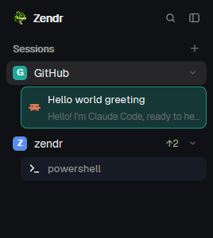

The left sidebar lists your **spaces** (one per project, with an avatar colour). Under each space are its **sessions**: each agent and each shell. A tab split into several terminals lists each of them as its own session; the tabs along the top stay as they are.

Every session tells you:
- **what it is**: Claude Code's crab, Codex's mark, or a shell prompt
- **what it's doing**: its current task, and a one-line summary read from its screen (*"Running the tests…"*, *"Do you want to apply this edit?"*)
- **whether it needs you**: <kbd>Needs you</kbd> in red, a spinning **Working**, a green **Done**, or how long it's been quiet

Click a session to jump into it. Drag it into the work area to put it **side by side** with the pane you're in, or **below** it, even from another tab. Right-click to give it a colour. Fold a busy space with its arrow; a folded space still shows how many sessions it has, coloured by the most urgent.

Spaces also say what they're up to: the **ports** their programs listen on (`:5173 :8080`), their branch's **pull request** (`PR #42`), their **session-bridge** status, and their latest unread notification.

<br clear="right">

### The toolbar: one row of labelled buttons

```text
 [ Hello world ✕ ] [ api ✕ ]  + ◫ ⊟ ⇄  │  </> Commands   ▯ Explorer   ▤ Code   ⑂ Graph   👥 Hub   🔔 Notifications ③  │  ─ ▢ ✕
```

No mystery icons. Each button says what it opens and **lights up while its panel is showing**. A space starts with just the terminal, and you open the rest when you want them. Each space remembers what it had open.

Beside **+** are **new terminal to the right**, **new terminal below** and **Arrange blocks**. On a narrow window the labels fold away and the buttons keep their icons and tooltips.

### The notifications drawer: what needs you comes first

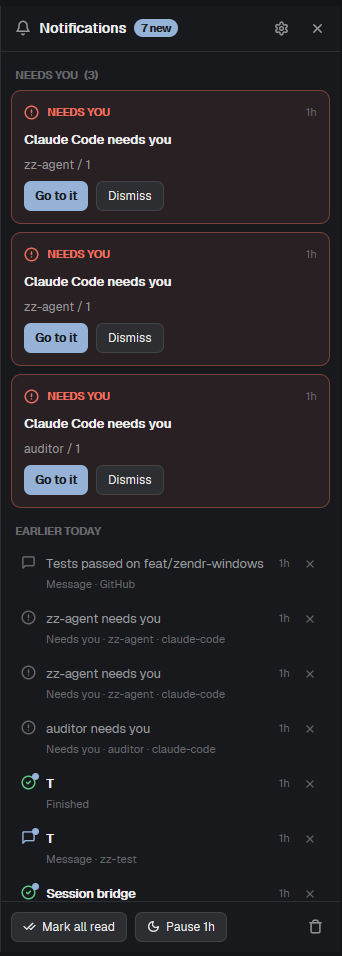

Zendr notices when an agent **stops to ask you something**, when it **finishes**, and when sessions **message each other**.

- What **needs you** is pinned at the top as a card: what it asked, where, and two buttons, **Go to it** and **Dismiss**.
- Everything else follows as a **quiet timeline**, grouped by day. Each kind is named in words and has its own icon, so nothing depends on colour alone.
- **Mark all read**, or **Pause 1h** for do not disturb.

<kbd>Ctrl</kbd> <kbd>Shift</kbd> <kbd>I</kbd> opens the drawer. <kbd>Ctrl</kbd> <kbd>Shift</kbd> <kbd>U</kbd> jumps straight to the newest unread.

A pane whose agent needs you also gets an **attention ring**: a tinted header with a coloured edge, so you spot it in a split. Finished work shows in **green**.

<br clear="right">

### The hub: a coordinator for your agents

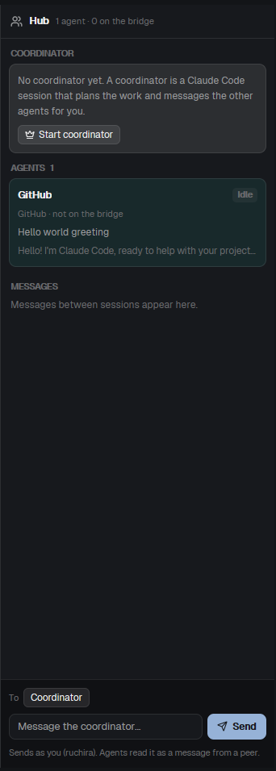

Running several agents on one job? The **Hub** drawer shows them together, with the **coordinator** apart at the top.

The coordinator is a Claude Code session that plans the work and hands parts of it to the others over the **[session bridge](https://github.com/iddhi-sulakshana/claude-mods/tree/main/claude-session-bridge)**. **Start coordinator** opens one in a new space with its brief.

Below the coordinator are every agent's card and the **messages between sessions**. At the bottom is a box for **you** to message the coordinator, one agent or everyone.

<br clear="right">

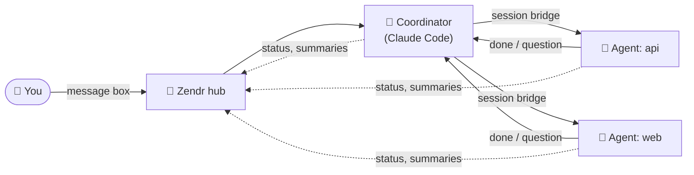

### A code editor beside your agent

<p align="center">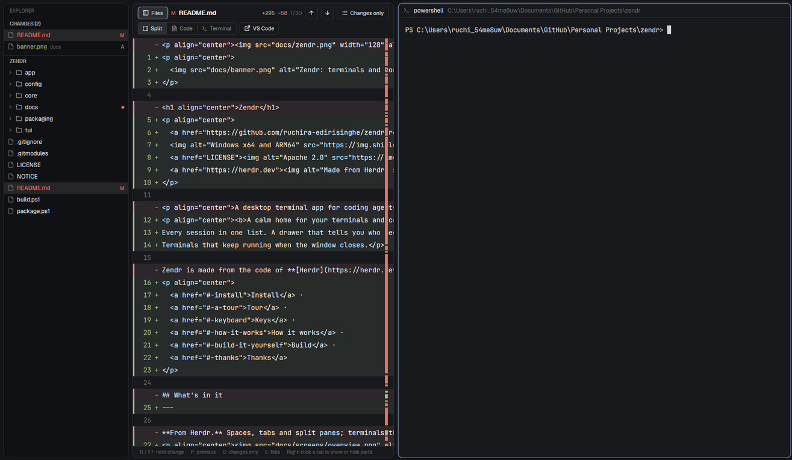</p>

Click **Explorer** and **Code** in the toolbar, and the space becomes a small IDE built for working alongside an agent:

- a **VS Code-style explorer** with the repo's changed files on top and the full tree below, each file with a **Seti-style icon** for its type
- a **Changes** panel on the right, for staging and committing; its toolbar button shows or hides it, and each space remembers your choice
- **tabs**: a single click previews a file, a double click (or an edit) keeps it open
- **Review** mode shows each file whole with its changes inline: removed lines in red, a ruler beside the scrollbar, <kbd>N</kbd> / <kbd>P</kbd> (or <kbd>F7</kbd>) to jump between changes and **Changes only** to fold the rest away
- **Edit** mode is a real editor: <kbd>Ctrl</kbd> <kbd>S</kbd> saves (line endings kept), and if the agent changes the file meanwhile you choose whose version wins
- **language detection** from the file name, a shebang (`#!/usr/bin/env python3`), a modeline or the content itself; click the language in the status bar to change it
- <kbd>Ctrl</kbd> + **mouse wheel** zooms the code in and out, to see more lines or fewer
- **Split editor** opens a second code view beside the first, and the toolbar's split buttons open more terminals. Open as many as you like.
- **VS Code** opens the file at the line you're reading

| Keys in the editor | Does |
| --- | --- |
| <kbd>Ctrl</kbd> <kbd>P</kbd> | Quick open a file (`:42` goes to a line, `>` runs an editor command) |
| <kbd>Ctrl</kbd> <kbd>G</kbd> | Go to line |
| <kbd>Ctrl</kbd> <kbd>F</kbd> | Search the code, starting on this file (a chip widens it to the whole repo) |
| <kbd>Ctrl</kbd> <kbd>H</kbd> | Replace |
| <kbd>Ctrl</kbd> <kbd>/</kbd> | Comment or uncomment the lines |
| <kbd>Ctrl</kbd> <kbd>]</kbd> / <kbd>[</kbd> | Indent / outdent |
| <kbd>Ctrl</kbd> <kbd>Alt</kbd> <kbd>↑</kbd> / <kbd>↓</kbd> | Add a cursor above / below |
| <kbd>Alt</kbd> <kbd>Z</kbd> | Word wrap |
| <kbd>Ctrl</kbd> <kbd>E</kbd> | Switch between Review and Edit |
| <kbd>Ctrl</kbd> <kbd>\</kbd> | Split the editor |
| <kbd>Ctrl</kbd> <kbd>W</kbd> | Close the tab |
| <kbd>F1</kbd> | Every editor shortcut |

### The source control graph

Click **Graph** in the toolbar for the repo's history in the right drawer: each commit on its **branch line**, with merges and forks drawn between them, and **branch and tag pills**. Uncommitted changes sit at the top. Click a commit to see its files, and click a file to open **that commit's change** in the code view. **All branches** shows the other branches too, and the graph refreshes itself when you commit.

### VS Code extensions

Already set up VS Code just the way you like it? Open **VS Code extensions** from the command palette (or the puzzle button in the code view's tabs). Zendr reads the extensions you have installed, built-in ones included, and lets you use:

- their **colour themes**, for the whole app (light or dark), with the theme's own **code colours** in the editor
- their **languages**, so files they know get detected and named in Zendr too

Zendr runs no extension code. It only reads the themes and language lists the extensions describe.

### Arrange the blocks

Want the drawer below the terminals instead of beside them? Click **Arrange blocks** in the toolbar (or run it from the command palette). Every block in the work area turns into a card:

- drag a card onto **another block's edge** to put it on that side: drop it on the bottom edge and it sits **below**
- drop it in the **middle** of a block to **swap** the two
- a highlight shows where it will land before you let go
- <kbd>Esc</kbd> or **Done** when you're finished

The new arrangement is saved to your layout and comes back next time.

### One search for everything

<kbd>Alt</kbd> <kbd>Space</kbd> opens a search across the whole app: your sessions, the repo's files, every command (with its shortcut), the settings and the notifications. <kbd>Ctrl</kbd> <kbd>F</kbd> (or <kbd>Tab</kbd> in the box) searches inside the code instead, with match case, regular expressions, and a chip for "this file" or "whole repo". In a folder that holds many projects, it searches each git repo inside it.

### Space icons and the space menu

Right-click a space for **New tab**, **New terminal**, **Rename**, **Change icon…** and **Colour…**. Change icon opens an emoji picker (search by name, groups, recently used) whose emoji then stands in for the space's letter in Sessions and the space picker. Emoji names come from [unicode-emoji-json](https://github.com/muan/unicode-emoji-json) by Mu-An Chiou (MIT).

### Colours, so you can tell sessions apart

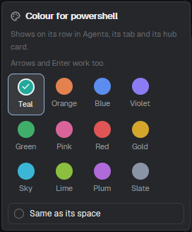

Give any session one of **twelve named colours**, or let it use its space's colour. The colour tints its whole row in Sessions, its tab and its hub card. The one you're in is brighter and outlined.

Right-click a session, a tab or a hub card, or press <kbd>Ctrl</kbd> <kbd>Shift</kbd> <kbd>Y</kbd>. Arrow keys and <kbd>Enter</kbd> work in the picker too.

<br clear="right">

### Warp-style power tools

<p align="center">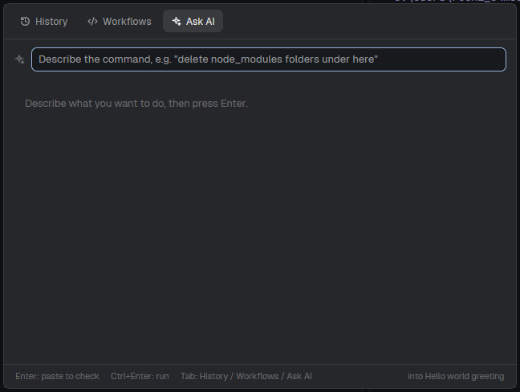</p>

| | |
| --- | --- |
| **Command suggestions** <kbd>→</kbd> or <kbd>Tab</kbd> | As you type at a shell prompt, the command you run most often that starts that way shows in grey after the cursor. <kbd>→</kbd> or <kbd>Tab</kbd> takes it; keep typing to ignore it. Zendr learns from the commands you run (starting from your PowerShell, bash or zsh history), never from agents' prompts, and skips commands that start with a space or look like they hold a password or token. **Clear command suggestions** in the palette forgets them all. |
| **Command search** <kbd>Ctrl</kbd> <kbd>Shift</kbd> <kbd>R</kbd> | Your shell history and saved workflows, in one searchable list. <kbd>Enter</kbd> pastes the command for you to check; <kbd>Ctrl</kbd> <kbd>Enter</kbd> runs it. |
| **Workflows** | Saved commands with `{{placeholders}}`. Zendr asks you to fill them in. Save one from history, or edit `workflows.json`. |
| **Ask AI** <kbd>Ctrl</kbd> <kbd>Shift</kbd> <kbd>Space</kbd> | Say what you want (*"find files over 100 MB"*) and Claude Code writes up to three commands for your shell. |
| **Launch configurations** <kbd>Ctrl</kbd> <kbd>Shift</kbd> <kbd>J</kbd> | Save your open spaces and tabs as a setup. Open it again tomorrow, and your agents start back up in their folders. |

### Make it yours, or keep it simple

<p align="center">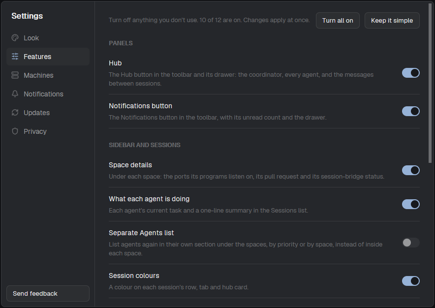</p>

**Settings → Features** has a switch for every extra, so Zendr can be as busy or as quiet as you like:

- **panels and toolbar**: the hub, the Notifications button, the source control graph, the explorer and code view, the new-terminal buttons and Arrange blocks
- **sidebar**: space details, agent summaries, session colours, session counts and the separate Agents list
- **code view**: editing (off makes it read-only), file-type icons, language detection, Ctrl + wheel zoom, VS Code extensions, shortcut hints and pane buttons
- **Warp-style tools**: each one on its own

**Keep it simple** turns all the extras off at once, and **Turn all on** brings them back.

**Settings → Claude mods** looks after the three [claude-mods](https://github.com/iddhi-sulakshana/claude-mods) plugins for Claude Code: **Next steps** (suggested next prompts as buttons), the **Session bridge** (sessions message each other; the hub uses it) and the **Model router** (each turn gets a matching reasoning effort). Turn each one on or off (Zendr installs it the first time), and open **Options** to change its settings. New Claude Code sessions pick up the changes.

**Settings → Notifications** sets, for each kind of notification, whether it pops up, plays a sound and goes to the drawer. It also covers do not disturb, how long pop-ups stay, the badge (number, dot or nothing), how many notifications to keep, and whether rings and sidebar lines show.

### Zendr on your phone

The **Zendr app for Android** shows every session on your computers, says which ones need you, and lets you answer from anywhere. Turn on **Alert me** and your phone buzzes when an agent needs you or finishes, even with the app closed. A tap on the alert opens that session.

- **Sessions** are grouped by space, with the ones that need you at the top. Filter them by *Needs you*, *Working* or *Done*, and pull down to refresh.
- **The terminal** shows the agent's screen in your computer's colours, sized to fit your phone's width. Pinch to zoom, or turn on *Wrap long lines*. It stays at the newest line, with a button to jump back down.
- **When an agent asks a question** (allow this command? 1. Yes 2. No), its choices are buttons.
- **The key bar** has **Esc**, **Tab**, the arrows, **Enter** and **Ctrl+C**. Send with an empty box presses Enter.
- **At a shell prompt**, the same command suggestions as on your computer show as you type. Tap one, or press → or Tab on a keyboard.

Your phone reaches your computer through [Tailscale](https://tailscale.com), a free private network that encrypts everything, so nothing on your computer is opened to the internet.

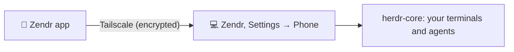

**Set it up once:**
1. Install **Tailscale** on your computer and your phone ([tailscale.com/download](https://tailscale.com/download), free for personal use) and sign in to the same account on both.
2. Install **Zendr-&lt;version&gt;-android.apk** on your phone.
3. On your computer, open **Settings → Phone → Show pairing code**.
4. In the app, tap **Add computer → Scan the code**. The 6-letter code under the QR code shows on both screens; they should match.

Add as many computers as you like: pair each one the same way, and the app lists them all with how many sessions need you on each. **Unpair all phones** (on the computer) makes a new code, and phones paired with the old one stop working. The phone connection is off until you show a pairing code, answers only over Tailscale unless you choose **Allow local network**, and **Turn off** stops it.

### Community add-ons, off until you want them

**Settings → Claude tools** and **Settings → Add-ons** offer 47 mods from the [Herdr gallery](https://herdr.dev/gallery/), made by people in the Herdr community. None is on when you install Zendr. Each card shows a picture, what it does, where it appears, what it needs (Node.js, Python 3, the GitHub CLI) and who made it. Search them, filter by on or off, topic and where they show, and flip a switch: the add-on appears at once, with no restart. Turning it off takes it out of the layout and deletes the copy; nothing else of yours is touched.

Every add-on ships unchanged with its author's licence (`config/addons/<name>/LICENSE`) and a `NOTICE.md` naming its author and source. Only MIT and Apache-2.0 mods are included. On Windows, mods written for macOS and Linux get Git for Windows' Unix tools and the `py` launcher for `python3`.

<details>
<summary>Every add-on and who made it</summary>

**Claude tools** (26)

| Add-on | What it does | Shows | By | Licence |
| --- | --- | --- | --- | --- |
| [Usage limits](https://github.com/nozikov/herdr-usage-limits/tree/main/) | Your Claude Code and Codex subscription limits in the Herdr status bar, always in view: every limit window each one reports (5-hour, weekly, per-model weekly such as Fable), with a bar, a pace tick, the percent used and, when it gets tight, the time to reset. | status bar | [nozikov](https://github.com/nozikov) | MIT |
| [Claude usage](https://github.com/cunderw/herdr-claude-usage/tree/main/) | How much of your Claude limits your agents are using, and when they'll run out. | popup | [cunderw](https://github.com/cunderw) | MIT |
| [Insights](https://github.com/GaganSD/coding-agent-toolkit/tree/main/herdr-insights) | A native Herdr dashboard for token usage across Pi, Codex, Claude Code, OpenCode, and Antigravity. | own tab | [GaganSD](https://github.com/GaganSD) | MIT |
| [Skill Ledger](https://github.com/felixfisher/herdr-skill-ledger/tree/main/) | A side panel that shows which skills and MCP servers a person really uses, counted from the local logs of Claude Code and Pi. | side panel | [felixfisher](https://github.com/felixfisher) | MIT |
| [Wrapped](https://github.com/adamentwistle/herdr-wrapped/tree/main/) | An overlay that shows a person their Claude Code stats as a card to share. | popup | [adamentwistle](https://github.com/adamentwistle) | MIT |
| [Agent sessions](https://github.com/cunderw/herdr-sessions/tree/main/) | A popup that finds any past Claude Code or Codex session, across every project, by its title, folder or what was said in it. | popup | [cunderw](https://github.com/cunderw) | MIT |
| [Revive](https://github.com/dmazlum/herdr-revive/tree/main/) | Revive brings back the coding agent a Herdr terminal lost to a reboot or a herdr-core restart, in the same pane, with the same session and flags. | popup | [dmazlum](https://github.com/dmazlum) | MIT |
| [Reopen closed tab](https://github.com/mustafaTokmak/herdr-reopen-tab/tree/main/) | Cmd+Shift+T for the Herdr desktop app, like a browser's: it brings back the tab you closed last, where it was in its space, with its name and its panes in their folders, and agents (Claude Code, Codex) pick up their last conversation there. | popup | [mustafaTokmak](https://github.com/mustafaTokmak) | MIT |
| [Claude tab name](https://github.com/iml885203/herdr-mods/tree/main/claude-tab-name) | A tab and its Claude Code session keep the same name: /rename in Claude renames the tab, and F2 renames both. | popup | [iml885203](https://github.com/iml885203) | MIT |
| [Recap](https://github.com/mrolafsson/herdr-recap/tree/main/app) | Come back to a dozen agents and know in seconds which ones need you. | popup | [mrolafsson](https://github.com/mrolafsson) | MIT |
| [Over9k Switcher](https://github.com/herunan/herdr-over9k/tree/main/over9k-switcher) | Jump between agents the way you switch apps. | popup | [herunan](https://github.com/herunan) | MIT |
| [Over9k Timeline](https://github.com/herunan/herdr-over9k/tree/main/over9k-timeline) | See exactly what happened, prompt by prompt. | side panel | [herunan](https://github.com/herunan) | MIT |
| [Prompt History](https://github.com/ReyArlena/herdr-mods/tree/main/prompt-history) | A panel that shows every prompt you gave a Claude Code agent in its current session, and what it answered, as a column of cards. | popup | [ReyArlena](https://github.com/ReyArlena) | MIT |
| [Prompt Jump](https://github.com/doominkim/herdr-prompt-jump/tree/main/) | A panel beside the terminals that lists, oldest first, the prompts the person typed into the focused Claude Code, Codex or omp session. | side panel | [doominkim](https://github.com/doominkim) | MIT |
| [Redpen](https://github.com/imutaroh/herdr-redpen/tree/main/) | Comment on Claude Code's latest reply, block by block, and send all the comments back as one message. | popup | [imutaroh](https://github.com/imutaroh) | MIT |
| [Fleece](https://github.com/dmazlum/herdr-fleece/tree/main/app) | Fleece pulls things out of a Claude Code or Codex agent's answers. | popup | [dmazlum](https://github.com/dmazlum) | MIT |
| [Claude goal](https://github.com/iml885203/herdr-mods/tree/main/claude-goal) | Write the next /goal for the Claude Code session you're in, with one key. | popup | [iml885203](https://github.com/iml885203) | MIT |
| [Agent review](https://github.com/jkuepker/herdr-mods/tree/main/agent-review) | A window that shows what an agent (Claude Code, Codex, any agent running in a Herdr terminal) changed in its repo since you last looked. | popup | [jkuepker](https://github.com/jkuepker) | MIT |
| [Walkthrough](https://github.com/dmazlum/herdr-walkthrough/tree/main/) | A dialog (or pane) that turns the diff of the focused terminal's repository into a guided reading: Claude groups related hunks into steps, orders them so each builds on the last, and explains what each step changes, with the step's code under the explanation. | popup | [dmazlum](https://github.com/dmazlum) | MIT |
| [Tourist](https://github.com/CodeyPacker/herdr-mods/tree/main/tourist) | A pane where Claude or Codex gives you a guided tour of code: your branch's changes, the last commit, the whole repo, or a feature you describe. | popup | [CodeyPacker](https://github.com/CodeyPacker) | MIT |
| [Session changes](https://github.com/iml885203/herdr-mods/tree/main/session-changes) | See what a Claude Code session changed across its repos, from a summary down to the diff. | popup | [iml885203](https://github.com/iml885203) | MIT |
| [Arena](https://github.com/dmazlum/herdr-arena/tree/main/) | Arena hands one task to several coding agents at once, each in its own git worktree, then lays their results out as cards: status, latest answer, +ins −del · N files and time. | popup | [dmazlum](https://github.com/dmazlum) | MIT |
| [Automations](https://github.com/DnzzL/herdr-automations/tree/main/app) | Scheduled agent prompts, as a side panel next to Files and Changes. | side panel | [DnzzL](https://github.com/DnzzL) | MIT |
| [Over9k To-do](https://github.com/herunan/herdr-over9k/tree/main/over9k-todo) | Agentic to-do lists, one per project, that your agents keep for you. | side panel | [herunan](https://github.com/herunan) | MIT |
| [Desk](https://github.com/CMehlstaeubler/herdr-desk/tree/main/) | A panel on the right of the window for the agent you're on: the questions it is waiting on you for, each with an answer box and its recommendation; the worklist it is working through; one-click prompt buttons; a notes area for your own ideas about that agent; and, for Claude Code agents, how full its context is. | side panel | [CMehlstaeubler](https://github.com/CMehlstaeubler) | MIT |
| [Herd](https://github.com/adamentwistle/herdr-herd/tree/main/) | A side panel, next to Files and Changes, that shows everything the Claude Code session in view has started. | side panel | [adamentwistle](https://github.com/adamentwistle) | MIT |

**Add-ons** (21)

| Add-on | What it does | Shows | By | Licence |
| --- | --- | --- | --- | --- |
| [Float Space](https://github.com/thuanlm215/herdr-float-space/tree/main/) | A floating scratch window over whatever Herdr shows: terminal tabs of its own and up to five named notes shared by every space. | popup | [thuanlm215](https://github.com/thuanlm215) | MIT |
| [Recall](https://github.com/shihyuho/herdr-recall/tree/main/) | Recall is recent + fuzzy. | popup | [shihyuho](https://github.com/shihyuho) | MIT |
| [Jump](https://github.com/CodeyPacker/herdr-mods/tree/main/jump) | A popup that lists every space with its tabs and jumps to one when you type its letter. | popup | [CodeyPacker](https://github.com/CodeyPacker) | MIT |
| [Find in Files](https://github.com/napalmpapalam/herdr-find-in-files/tree/main/) | A key opens a dialog over the window, like JetBrains' Find in Files. | popup | [napalmpapalam](https://github.com/napalmpapalam) | MIT |
| [Kiosk](https://github.com/thomasschafer/kiosk/tree/main/) | A fuzzy finder for your Git repositories and their branches, opened in a large popup over the window. | popup | [thomasschafer](https://github.com/thomasschafer) | MIT |
| [Open with](https://github.com/jlopezlira/herdr-kanso/tree/main/open-with) | Cmd+Shift+O opens a small picker at the top of the window that opens the focused pane's folder in a code editor installed on this computer. | popup | [jlopezlira](https://github.com/jlopezlira) | Apache-2.0 |
| [SSH hosts](https://github.com/thebends2k/herdr-ssh-hosts/tree/main/) | An SSH row in the sidebar that opens a searchable list of the hosts in your ~/.ssh/config, grouped by the comments in that file. | popup | [thebends2k](https://github.com/thebends2k) | MIT |
| [Run](https://github.com/CodeyPacker/herdr-mods/tree/main/run) | A popup that runs the processes a repo declares (dev server, API, workers) as background herdr-core terminals and lets you start, stop, restart and peek at them with single keys. | popup | [CodeyPacker](https://github.com/CodeyPacker) | MIT |
| [run-scripts](https://github.com/cybertron288/herdr-mods/tree/main/run-scripts) | A small run control for JavaScript projects, in the style of Android Studio. | side panel | [cybertron288](https://github.com/cybertron288) | MIT |
| [Greenflagged](https://github.com/greenflagged/herdr-greenflagged/tree/main/) | A dependency tree viewer for Herdr. | side panel | [greenflagged](https://github.com/greenflagged) | MIT |
| [GitHub](https://github.com/mrolafsson/herdr-github/tree/main/app) | Your pull requests in one popup, sorted by whose move it is: yours, the ones waiting on your review, and this repo's. | popup | [mrolafsson](https://github.com/mrolafsson) | MIT |
| [Markdown panel](https://github.com/jlopezlira/herdr-kanso/tree/main/markdown-panel) | The plans, notes and reviews your agents write, in a window over any layout: formatted, and edited where they read. | popup | [jlopezlira](https://github.com/jlopezlira) | Apache-2.0 |
| [herdr-md](https://github.com/ryanthedev/herdr-md/tree/main/) | A markdown file rendered natively in a Herdr pane (real heading sizes, theme colors, tables, images, typeset math, Mermaid diagrams) that a coding agent can drive from the shell: it highlights blocks, attaches notes and glides the view to them, and reads back what the person selected. | beside the terminal | [ryanthedev](https://github.com/ryanthedev) | MIT |
| [Tab notes](https://github.com/ozcberkay/herdr-coban/tree/main/tab-notes) | A notes panel that follows the tab you're looking at. | side panel | [ozcberkay](https://github.com/ozcberkay) | Apache-2.0 |
| [Blueprint](https://github.com/chappse6/herdr-blueprint-app/tree/master/) | A pane (or tab-bar side panel) that draws what the tab's coding agent is building. | side panel | [chappse6](https://github.com/chappse6) | MIT |
| [Vitals](https://github.com/mrolafsson/herdr-vitals/tree/main/app) | How the machine your agents run on is doing, live, in a window that stays beside your work. | popup | [mrolafsson](https://github.com/mrolafsson) | MIT |
| [PageMe](https://github.com/adamentwistle/herdr-pageme/tree/main/) | A panel and a small daemon. | popup | [adamentwistle](https://github.com/adamentwistle) | MIT |
| [herdr-pets](https://github.com/Aryan1092raj/Herdr-pets/tree/main/) | A strip along the bottom of the window where every running agent is a small pixel creature that roams the whole row. | window edge | [Aryan1092raj](https://github.com/Aryan1092raj) | MIT |
| [Lichess](https://github.com/Ghamza-Jd/herdr-lichess/tree/master/) | A side panel that brings Lichess into Herdr: the puzzle of the day, Lichess TV with live moves, and your own games, from finding an opponent to stepping through what you played. | side panel | [Ghamza-Jd](https://github.com/Ghamza-Jd) | MIT |
| [Jumpy Critter](https://github.com/adamentwistle/herdr-jumpy-critter/tree/main/) | A one-button game in a dialog over the window. | popup | [adamentwistle](https://github.com/adamentwistle) | MIT |
| [Crawlspace](https://github.com/adamentwistle/herdr-crawlspace/tree/main/) | A first-person shooter in a dialog over the window, to play while agents work. | popup | [adamentwistle](https://github.com/adamentwistle) | MIT |

</details>

## ⌨ Keyboard

| Keys | Does |
| --- | --- |
| <kbd>Ctrl</kbd> <kbd>Shift</kbd> <kbd>N</kbd> | New space |
| <kbd>Ctrl</kbd> <kbd>Shift</kbd> <kbd>T</kbd> | New tab |
| <kbd>Ctrl</kbd> <kbd>Shift</kbd> <kbd>O</kbd> / <kbd>E</kbd> | Split right / down |
| <kbd>Ctrl</kbd> <kbd>Shift</kbd> <kbd>Z</kbd> | Zoom a pane |
| <kbd>Alt</kbd> <kbd>↑</kbd> / <kbd>↓</kbd> | Previous / next agent |
| <kbd>Alt</kbd> <kbd>1</kbd>…<kbd>9</kbd> · <kbd>Ctrl</kbd> <kbd>1</kbd>…<kbd>9</kbd> | Go to a space · a tab |
| <kbd>Ctrl</kbd> <kbd>Shift</kbd> <kbd>I</kbd> | Notifications drawer |
| <kbd>Ctrl</kbd> <kbd>Shift</kbd> <kbd>U</kbd> | Jump to the newest unread |
| <kbd>Ctrl</kbd> <kbd>Shift</kbd> <kbd>Y</kbd> | Colour the session you're in |
| <kbd>Alt</kbd> <kbd>Space</kbd> | Search everything: sessions, files, commands, settings, notifications |
| <kbd>Ctrl</kbd> <kbd>F</kbd> | Search the code of the repo you're in (<kbd>Tab</kbd> switches between the two) |
| <kbd>→</kbd> or <kbd>Tab</kbd> | Take the grey command suggestion at a shell prompt |
| <kbd>Ctrl</kbd> <kbd>Shift</kbd> <kbd>R</kbd> | Command search |
| <kbd>Ctrl</kbd> <kbd>Shift</kbd> <kbd>Space</kbd> | Ask AI for a command |
| <kbd>Ctrl</kbd> <kbd>Shift</kbd> <kbd>J</kbd> | Launch configurations |
| <kbd>Ctrl</kbd> <kbd>Shift</kbd> <kbd>P</kbd> | Command palette: every command, by name |
| <kbd>Ctrl</kbd> <kbd>,</kbd> | Settings |
| <kbd>Ctrl</kbd> <kbd>Shift</kbd> <kbd>B</kbd> | Show or hide the sidebar |
| <kbd>Ctrl</kbd> <kbd>=</kbd> / <kbd>-</kbd> / <kbd>0</kbd> | Zoom the whole app in / out / back |

Change any of them in `%USERPROFILE%\.config\herdr-app\keys.json`.

## 🧠 How it works

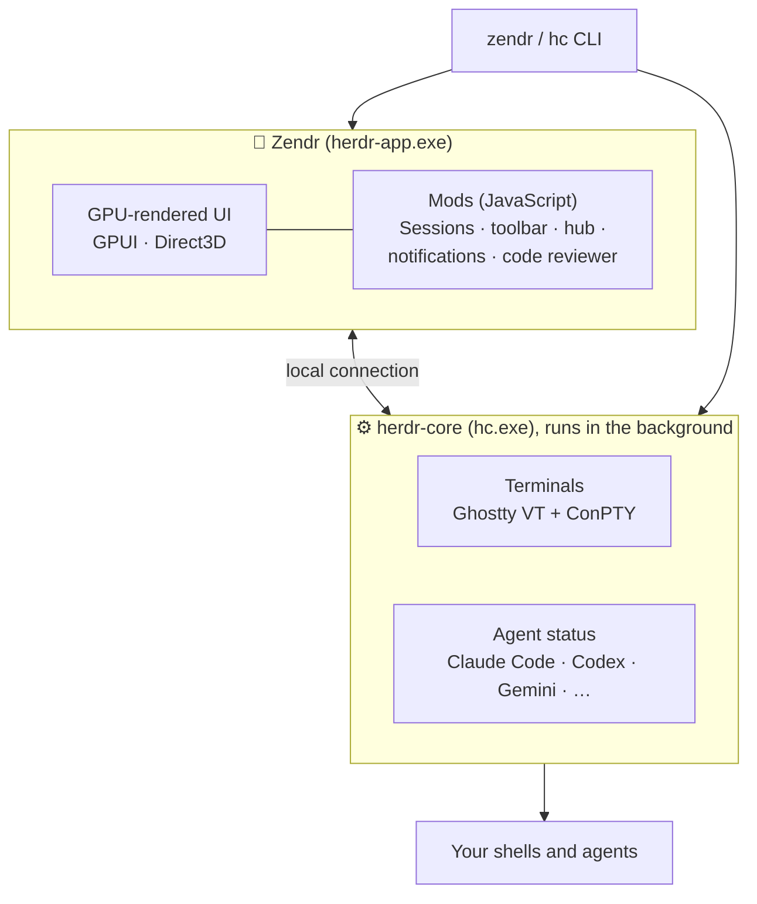

- **The core keeps your terminals.** Close Zendr, update it, or restart it: your agents keep working in `herdr-core`. When Zendr comes back, they're all still there.
- **Everything you see is a mod.** The Sessions list, the toolbar, the drawers and the code reviewer are small JavaScript files in `~\.config\herdr-app\mods`. They hot-reload when you edit them, so you can change any of them.
- **Agents are recognised by the core.** It knows Claude Code, Codex, Gemini, OpenCode, Amp and others, and reports when each one is working, waiting on you or done.

## 🔨 Build it yourself

You need:
- **Rust**, with the target you're building (`rustup target add x86_64-pc-windows-msvc` or `aarch64-pc-windows-msvc`)
- **Visual Studio Build Tools**, with the C++ tools for that architecture and the Windows SDK
- **LLVM** (`clang`, `libclang`)
- **Zig 0.16.0**. On ARM64, use the x64 Zig; the native ARM64 one crashes on some Windows 11 builds.

Paths are listed at the top of `app/scripts/build-windows-arm64.ps1`.

```powershell
git clone https://github.com/ruchira-edirisinghe/zendr
cd zendr

# Build and install on this PC (ARM64)
powershell -ExecutionPolicy Bypass -File .\build.ps1

# Or make an installable zip, for either architecture, from either kind of PC
powershell -ExecutionPolicy Bypass -File .\package.ps1 -Arch x64     # dist\Zendr-<version>-windows-x64.zip
powershell -ExecutionPolicy Bypass -File .\package.ps1 -Arch arm64   # dist\Zendr-<version>-windows-arm64.zip
```

Already have Herdr? `.\config\install.ps1` adds only Zendr's mods, layout and shortcuts.

<details>
<summary><b>What's in this repository</b></summary>

| Folder | What it is | Made from |
| --- | --- | --- |
| `app/` | The Zendr desktop app (Rust, GPUI, Direct3D) | [herdr-app](https://github.com/herdrdev/herdr-app) v0.1.18 |
| `core/` | herdr-core and its CLI `hc`, which run the terminals | [herdr-core](https://github.com/herdrdev/herdr-core) v0.1.22, with Windows ARM64 fixes |
| `tui/` | herdr, Herdr's terminal UI, with a Windows ARM64 build script | [herdr](https://github.com/herdrdev/herdr) v0.9.5 |
| `config/` | Zendr's mods, layout, shortcuts and `install.ps1` | New, and clones of Herdr's built-in mods |
| `packaging/` | The installer that goes in each release zip | New |
| `build.ps1`, `package.ps1` | Build and install here, or build a release zip | New |

`app/`, `core/` and `tui/` are git subtrees, and each keeps its upstream license and notices. Their full histories are on the `zendr` and `windows-arm64` branches of [herdr-app](https://github.com/ruchira-edirisinghe/herdr-app/tree/zendr), [herdr-core](https://github.com/ruchira-edirisinghe/herdr-core/tree/windows-arm64) and [herdr](https://github.com/ruchira-edirisinghe/herdr/tree/windows-arm64).

**Changes from Herdr:**
- **app:** the name Zendr and the pixel-iguana logo; Settings sections for Notifications (which the app follows: pop-up length, do not disturb, sounds by kind) and Features; green for finished agents; and Windows build scripts.
- **core:** a static CRT, Microsoft's ConPTY for each architecture, and an installer that takes a local zip.

To update from Herdr:

```powershell
git subtree pull --prefix=app https://github.com/herdrdev/herdr-app master --squash
git subtree pull --prefix=core https://github.com/herdrdev/herdr-core master --squash
```
</details>

## 💚 Thanks

Zendr stands on two projects:

- **[Herdr](https://herdr.dev)** ([herdrdev](https://github.com/herdrdev)) is the software Zendr is made from. Herdr does the hard part: terminals that keep running in a background core, agent status, spaces and tabs, the mod system and the GPU-rendered UI. Zendr is Herdr's desktop app, renamed, with a new face and a set of mods.
- **[cmux](https://cmux.com)** by Manaflow inspired the notifications, attention rings, the sidebar's status lines and agent summaries. No cmux code is included.
- **[Warp](https://www.warp.dev)** inspired command suggestions, command search, workflows, Ask AI and launch configurations. No Warp code is included.
- **The Herdr community**: the authors of the add-ons in Settings → Claude tools and Settings → Add-ons, each credited above and in its `NOTICE.md`.

## License

Apache License 2.0, the same as Herdr: see [LICENSE](LICENSE) and [NOTICE](NOTICE). "Herdr" is the Herdr authors' name for their software. Zendr is a separate build, not made or endorsed by the Herdr authors, Manaflow or Warp.
